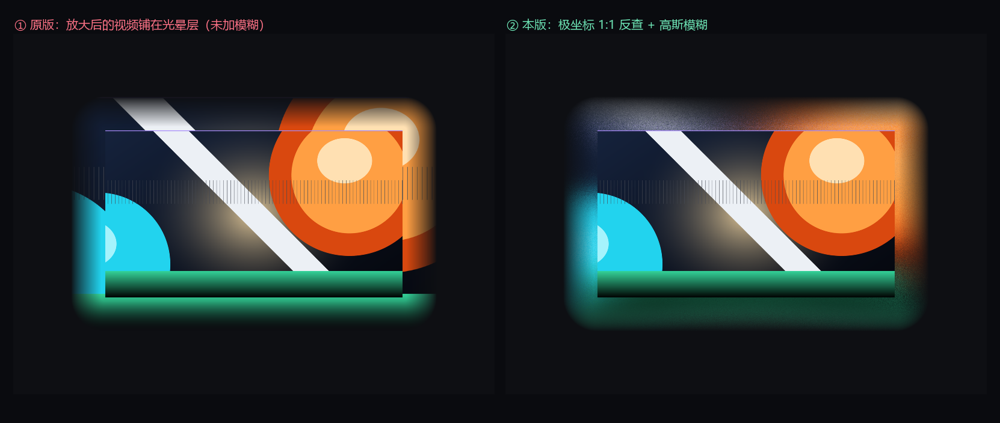
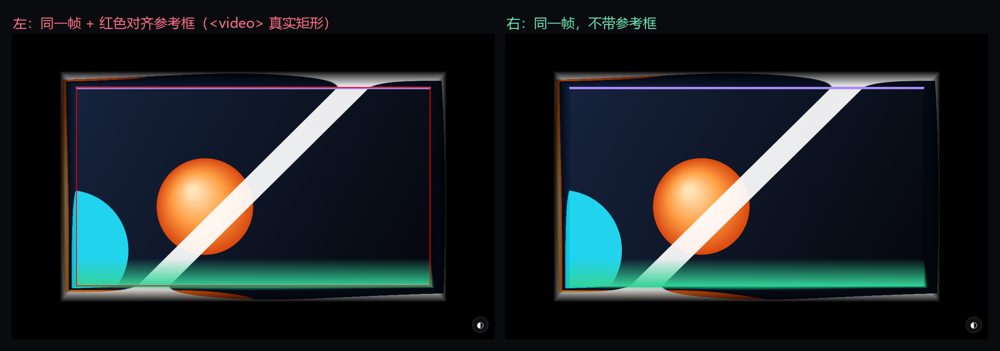

# YouTube 氛围灯 · 径向反查版 (Ambilight Mirror)

给视频加一圈"从画面中心向外扩散"的氛围光晕，颜色不是取自被拉长的边缘像素，而是**沿半径回到画面内部回查**得到的真实像素。

复刻自 [WesselKroos/youtube-ambilight](https://github.com/WesselKroos/youtube-ambilight)，但取色方式换成了极坐标反查，并做了几处针对性优化。


## 它和原版的区别

| | 原版 (youtube-ambilight) | 本脚本 |
|---|---|---|
| 光晕取色 | 画布比视频大 `scale` 倍，铺上放大后的整幅视频，越界部分交给 `CLAMP_TO_EDGE` | 以画面中心为极点，沿「中心 → 像素」的半径回到画面内部回查 |
| 光晕范围 | 只有视频周围一圈（`spread` 百分比） | 铺满整个视口，可以一直漫到屏幕边缘 |
| 模糊 | 2D canvas `filter: blur()` | 同样用 `filter: blur()`，但不是低分辨率再放大 |
| 角落 | 径向厚度是边上的 √2 倍，容易出折痕 | 按方向归一化，边和角取色深度一致 |



## 核心逻辑

**1. 极坐标取色（严格 1:1）**

```glsl
vec2  center = hi * 0.5;            // 极点 = 画面中心
vec2  v      = p - center;
float r      = length(v);           // 半径
vec2  dir    = v / r;               // 极角方向

// 这条半径与画面边界的交点距离
float rEdge = min(halfSize.x / abs(dir.x), halfSize.y / abs(dir.y));

// 往外延展多远，就往画面里回查多远（最多到中心）
float s  = min(r - rEdge, rEdge);
float rr = rEdge - s;
vec3 col = texture(uTex, clamp(center + dir * rr, 0.0, hi)).rgb;
```

- `s = 0`（贴着画面）→ 取边界像素，和视频接缝连续；
- 越往外 `s` 越大，颜色越深入画面；
- 采样永远落在画面内，不依赖 mipmap 兜底。

**2. 透明度用欧氏距离**

```glsl
vec2  over = max(-pM, pM - hiM);
float t = clamp(length(max(over, 0.0)) / uExpand, 0.0, 1.0);
```

用 `length` 而不是 `max(Δx, Δy)`，等值线是圆角矩形，四个角不会出现直角硬边。

**3. 浏览器原生高斯模糊**

WebGL 渲染到离屏画布，再由 2D canvas 做模糊（和原版一致，不在着色器里多 tap 采样，所以没有颗粒噪点）：

```js
const blurPx = settings.blur * (state.ch / 512) * 1.275;   // 原版公式
dctx.filter = 'blur(' + blurPx + 'px)';
dctx.drawImage(state.glCanvas, 0, 0, out.width, out.height);
```

**4. 画面与光晕一起模糊，边缘溶入**

着色器里画面内部也填上原视频像素（不是透明），整图一起模糊；合成时再用「向内羽化」把画面挖开，露出原始 `<video>`：

```js
const feather = Math.min(blurPx, Math.min(pw, ph) * 0.12);
dctx.globalCompositeOperation = 'destination-out';
dctx.filter = 'blur(' + (feather * 0.5) + 'px)';
dctx.fillRect(px + feather * 0.5, py + feather * 0.5, pw - feather, ph - feather);
```

于是视频边缘一圈是半透明的，模糊后的光晕色和原视频像素在那里叠在一起，看不到图层边界。



## 安装

1. 浏览器安装 [Tampermonkey](https://www.tampermonkey.net/)
2. 打开 Tampermonkey 管理面板 → 添加新脚本 → 把 `youtube-ambilight-mirror.user.js` 的内容粘进去 → `Ctrl+S`
   （或者直接把 `.user.js` 拖进浏览器窗口）

打开任意带 `<video>` 的页面，右下角出现 **◐** 按钮。点开调参，设置存在 `localStorage`。

## 参数

| 参数 | 默认 | 说明 |
|---|---|---|
| 采样方式 | 径向反查 1:1 | 另有「镜像折叠」「边缘拉伸（原版）」可切换对照 |
| 扩散范围 | 120% | 光晕衰减范围（占视口短边）。120 ≈ 铺满屏幕，60~80 更局部 |
| 模糊 | 32 | 对应 `blurPx = 32 × (画布高/512) × 1.275` |
| 不透明度 | 92% | 光晕强度 |
| 渐变起点 / 曲线 | 0.12 / 0.85 | 透明度沿距离的衰减形状 |
| 亮度 / 对比度 / 饱和度 / 色彩 | 100 / 104 / 112 / 100 | 只作用于光晕，不动视频 |
| 采样分辨率 | 60% | 上传给 GPU 的帧尺寸，越低越省电 |
| 帧率上限 | 30 fps | |
| 抖动 | 0 | 抗色带用的噪声，默认关 |

## 已知限制

- 跨域且未开放 CORS 的视频读不到像素，会提示并停用；
- DRM 视频（YouTube 付费内容）取帧是黑屏；
- 全屏时画布被限制在全屏元素内；
- 渲染区域是整个视口，性能开销比原版大。卡顿就把「采样分辨率」降到 40~50%、帧率降到 24。

## 文件

| 文件 | 说明 |
|---|---|
| `youtube-ambilight-mirror.user.js` | 油猴脚本本体 |
| `demo-mirror-vs-clamp.html` | 浏览器实时对比页（左：边缘拉伸 / 右：径向反查，可切镜像） |
| `test-video.html` | 本地端到端测试页（canvas 生成动画 → captureStream → video） |
| `tools/sim_compare.py` | CPU 逐像素仿真，生成对比图 |

## 致谢

取色思路来自 [WesselKroos/youtube-ambilight](https://github.com/WesselKroos/youtube-ambilight)（MIT）。

## License

MIT
