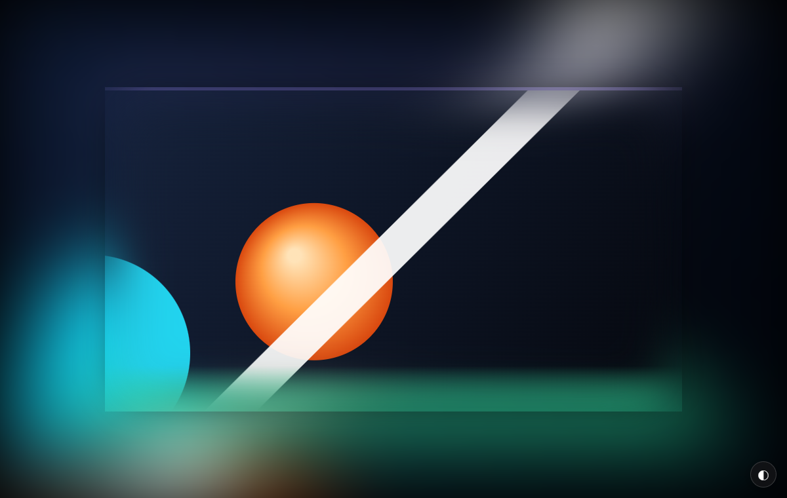

# YouTube 氛围灯 · 径向反查版 (Ambilight Mirror)

> 中文 | [English](README.en.md)

给网页里的视频加一圈氛围光晕：以画面中心为极点向外扩散，颜色沿半径回到画面内部取样。\n\n支持 **YouTube** 与 **Bilibili**（www / player）。B 站会按页面背景亮度自动切换混合模式：暗夜模式用普通混合（发光），浅色模式用 multiply（染色且不糊字）。

## 特性

- **径向取色** — 以画面中心为极点，光晕往外延展多远，就往画面里回查多远（1:1），光晕颜色始终来自画面里的真实像素
- **全屏扩散** — 光晕覆盖整个视口，不局限于视频周围一圈
- **浏览器原生高斯模糊** — 用 2D canvas 的 `ctx.filter: blur()` 完成，没有多 tap 采样带来的颗粒噪点
- **边缘溶入** — 画面与光晕一起模糊，再把画面向内羽化，视频边缘半透明地融进光晕
- **不依赖 mipmap** — 全程 `highp` 计算，不会出现色块和量化台阶

## 安装

先装 [Tampermonkey](https://www.tampermonkey.net/)，然后：

> 👉 **[安装脚本](https://raw.githubusercontent.com/huyexiusan/yet-another-youtube-ambilight/main/youtube-ambilight-mirror.user.js)**

点开会自动弹出安装页。也可以把 `youtube-ambilight-mirror.user.js` 拖进浏览器窗口，或复制内容到 Tampermonkey「添加新脚本」。

## 使用

打开任意带 `<video>` 的页面，右下角出现 **◐** 按钮，点开调参。设置保存在 `localStorage`。

面板里的「采样方式」提供三种取色方式：径向反查 1:1（默认）、镜像折叠、边缘拉伸，可随时切换。

## 参数

| 参数 | 默认 | 说明 |
|---|---|---|
| 采样方式 | 径向反查 1:1 | 径向反查 / 镜像折叠 / 边缘拉伸 |
| 扩散范围 | 120% | 光晕淡出的范围（占视口短边），120 ≈ 铺满屏幕 |
| 模糊 | 32 | 对应 `blurPx = 32 × (画布高 / 512) × 1.275` |
| 不透明度 | 92% | 光晕整体强度 |
| 渐变起点 / 曲线 | 0.12 / 0.85 | 透明度沿距离的衰减形状 |
| 亮度 / 对比度 / 饱和度 / 色彩 | 100 / 104 / 112 / 100 | 只作用于光晕，不改视频本身 |
| 采样分辨率 | 60% | 上传给 GPU 的帧尺寸，越低越省电 |
| 帧率上限 | 30 fps | 光晕刷新率 |
| 抖动 | 0 | 抗色带的噪声，默认关闭 |

## 已知限制

- 跨域且未开放 CORS 的视频读不到像素，脚本会提示并停用
- DRM 视频（YouTube 付费内容）取帧为黑屏
- 全屏时画布被限制在全屏元素内部
- 渲染区域是整个视口，开销比只渲染一圈更大。卡顿就把「采样分辨率」降到 40~50%、帧率降到 24
- B 站旧版 wp-video 播放器使用 closed shadow root，无法读取帧，脚本会自动跳过

## 文件

| 文件 | 说明 |
|---|---|
| `youtube-ambilight-mirror.user.js` | 油猴脚本本体 |
| `demo-mirror-vs-clamp.html` | 浏览器实时对比页 |
| `test-video.html` | 本地端到端测试页（canvas → captureStream → video） |
| `tools/sim_compare.py` | CPU 逐像素仿真，用于生成对比图 |

## License

MIT。

取色思路参考 [WesselKroos/youtube-ambilight](https://github.com/WesselKroos/youtube-ambilight)（MIT）。
